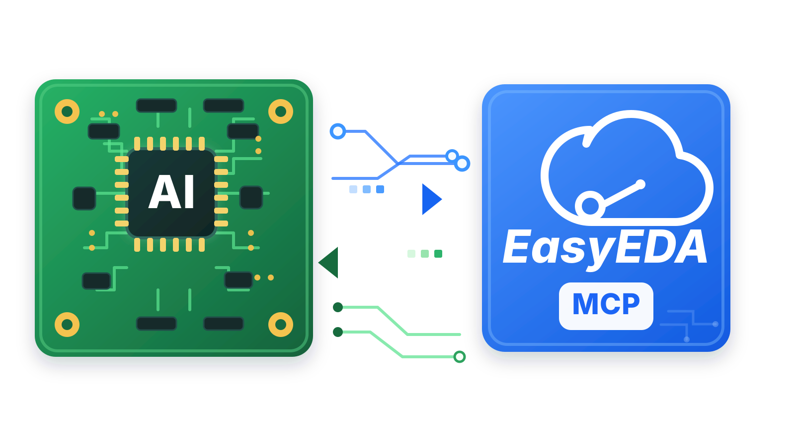
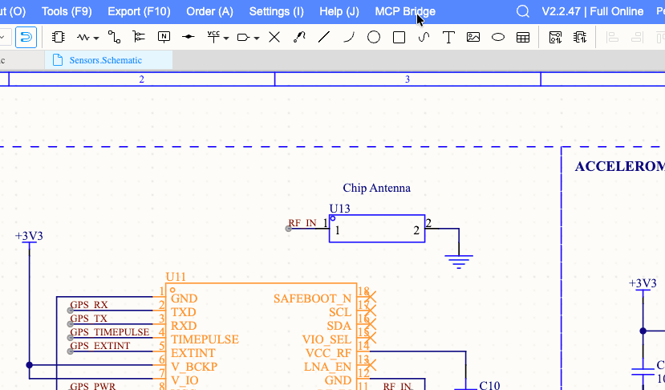

<p align="center">
  
</p>

<h1 align="center">EasyEDA Pro MCP</h1>

<p align="center">
  Connect Claude, Codex, VS Code, and other Model Context Protocol (MCP) clients to the live EasyEDA Pro project already open on your machine.
</p>

<p align="center">
  Independent open-source MCP bridge for live schematic and PCB workflows in EasyEDA Pro.
</p>

<p align="center">
  <a href="https://github.com/VLab-Software/easyeda_mcp/actions/workflows/ci.yml"></a>
  <a href="https://github.com/VLab-Software/easyeda_mcp/releases"></a>
  <a href="./LICENSE"></a>
  
  
</p>

<p align="center">
  <a href="https://vlabsoft.org/easyeda_mcp/quick-start">Quick Start</a>
  ·
  <a href="https://vlabsoft.org/easyeda_mcp/ai-client-setup">AI Client Setup</a>
  ·
  <a href="https://vlabsoft.org/easyeda_mcp/tools">Tools</a>
  ·
  <a href="https://vlabsoft.org/easyeda_mcp/troubleshooting">Troubleshooting</a>
  ·
  <a href="https://github.com/VLab-Software/easyeda_mcp/releases">Releases</a>
</p>

<p align="center">
  
</p>

## Overview

EasyEDA Pro MCP gives AI assistants structured, live access to your open EasyEDA Pro schematic or PCB — no screenshots or manual file exports needed.

```text
AI Client (stdio) ──▶ Local MCP Server ──▶ WebSocket (127.0.0.1:8765) ──▶ EasyEDA Pro Extension
```

## Quick Start

### 1. Build Server & Extension

```bash
npm install
npm run setup:local
```

This generates `dist/index.js` (MCP server) and `build/dist/easyeda_mcp_bridge.eext` (EasyEDA Pro extension — also available on [GitHub Releases](https://github.com/VLab-Software/easyeda_mcp/releases/latest)).

### 2. Connect Your AI Client

Point your MCP client to `/absolute/path/to/easyeda_mcp/dist/index.js`:

- **Claude Code CLI**: `claude mcp add easyeda-pro -- node /absolute/path/to/easyeda_mcp/dist/index.js`
- **Codex CLI**: `codex mcp add easyeda-pro -- node /absolute/path/to/easyeda_mcp/dist/index.js`
- **Claude Desktop / Cursor / Antigravity**:
  ```json
  {
    "mcpServers": {
      "easyeda-pro": {
        "command": "node",
        "args": ["/absolute/path/to/easyeda_mcp/dist/index.js"]
      }
    }
  }
  ```
- **VS Code (Copilot)**: see [AI Client Setup](https://vlabsoft.org/easyeda_mcp/ai-client-setup#vs-code)

### 3. Load Extension & Verify

1. In EasyEDA Pro (`>= 2.3.0`), import `build/dist/easyeda_mcp_bridge.eext` and enable **Allow interactive with external**.
2. Open a schematic or PCB document (use **MCP Bridge -> Reconnect** if needed).
3. Ask your AI client: `Run easyeda_doctor` — verify `connected: true`, `compatible: true`, and `activeDocument.available: true`.

## Capabilities & Example Prompts

| Area | What It Supports |
| --- | --- |
| **Live Context** | Active project, open tabs, document type, and bridge health (`easyeda_doctor`, `easyeda_get_context`) |
| **Schematic Review** | Normalized snapshots, component/pin search, net & component tracing, unconnected pin detection, and connection assertions |
| **PCB Design Rules (DRC)** | Native rule reads (`current`, `configurations`, `netRules`, `netByNetRules`, `regionRules`), immutable previews, and confirmed updates |
| **Navigation & Exports** | Jump to components/regions, zoom board outline, and export BOM, netlist, Gerber, or PDF |
| **Confirmed Actions** | Explicit confirmation gate for mutating editor actions (`save`, `importChanges`, `autoroute`, `autolayout`, `editDrcRules`) |

```text
Run easyeda_doctor and check if the EasyEDA Pro bridge is healthy.
Run easyeda_schematic_snapshot and summarize components, nets, and warnings.
Run easyeda_trace_component for USB1 and list its connected nets.
Run easyeda_get_drc_rules for the current PCB configuration and summarize active clearances.
```

## Documentation

- [Quick Start](https://vlabsoft.org/easyeda_mcp/quick-start) · [AI Client Setup](https://vlabsoft.org/easyeda_mcp/ai-client-setup) · [Extension Setup](https://vlabsoft.org/easyeda_mcp/easyeda-extension) · [Upgrading & Compatibility](https://vlabsoft.org/easyeda_mcp/upgrading)
- [Practical Workflows](https://vlabsoft.org/easyeda_mcp/workflows) · [Tools Reference](https://vlabsoft.org/easyeda_mcp/tools) · [DRC Rule Editing](./docs/drc-rules.md) · [Architecture](https://vlabsoft.org/easyeda_mcp/architecture) · [Safety Model](https://vlabsoft.org/easyeda_mcp/safety)
- [Troubleshooting](https://vlabsoft.org/easyeda_mcp/troubleshooting) · [Changelog](./docs/changelog.md) · [Releases](https://github.com/VLab-Software/easyeda_mcp/releases)

## Development

```bash
npm run setup:local          # Build server, extension bundle, and .eext package
npm test                     # Run unit tests
npm run typecheck            # Typecheck MCP server
npm run typecheck:extension  # Typecheck EasyEDA extension
npm run test:smoke:drc       # End-to-end stdio + WebSocket DRC smoke test
npm run docs:build           # Build VitePress documentation site
```

## Scope, Security & License

- **Live session required**: operates on the project open in EasyEDA Pro (no offline `.epro` parsing or commercial/order automation).
- **Localhost only**: WebSocket bridge binds to `127.0.0.1:8765` by default. Do not expose it to untrusted networks. See [SECURITY.md](./SECURITY.md).
- **Disclaimer**: Independent open-source project. Not affiliated with, endorsed by, or sponsored by EasyEDA, JLCPCB, or Shenzhen Jia Chuang Ban Technology Co., Ltd.
- **Contact & License**: [victor.freitas@vlabsoft.com](mailto:victor.freitas@vlabsoft.com) · [MIT License](./LICENSE).
