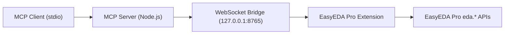

# Architecture

The MCP client communicates with a local Node.js server over `stdio`. The server bridges RPC requests over localhost WebSocket to the EasyEDA Pro extension, which calls `eda.*` APIs on the open project.

## Components

| Module | Path | Responsibility |
| --- | --- | --- |
| **CLI Entrypoint** | `src/index.ts` | Starts the WebSocket bridge, attaches `StdioServerTransport`, and handles graceful shutdown. |
| **WebSocket Bridge** | `src/bridge/EasyEdaBridge.ts` | Listens on `ws://127.0.0.1:8765`, tracks extension handshake/compatibility, and dispatches timed RPC calls. |
| **MCP Tool Registry** | `src/mcp/registerTools.ts` | Registers all 24 MCP tools, Zod input schemas, tool annotations, and confirmation guards. |
| **Schematic Engine** | `src/schematic/analysis.ts` | Normalizes schematic primitives, traces nets/components, and evaluates circuit assertions. |
| **DRC Contracts** | `src/drc/contracts.ts` | Shared browser-safe Zod schemas and canonical JSON validation for DRC operations. |
| **Extension Host** | `extension/src/index.ts` | Connects via `eda.sys_WebSocket`, reports active document state, and routes bridge RPC methods. |
| **DRC Handler** | `extension/src/drcRules.ts` | Executes `eda.pcb_Drc` reads, stages immutable previews, validates PCB target identity, and verifies writes via readback. |
| **Release Identity** | `src/version.ts` | Single source of truth for server (`1.1.0`) and extension (`0.2.0`) versions, verified against manifests in `src/version.test.ts`. |

## Request Lifecycle

1. **Tool call**: AI client invokes an MCP tool over `stdio`.
2. **Validation**: MCP server validates arguments with Zod (and blocks unconfirmed mutations before dispatch).
3. **Bridge RPC**: Server sends `{ kind: "call", requestId, method, params }` over WebSocket.
4. **Editor API**: Extension calls `eda.*` APIs against the live EasyEDA Pro session and returns `{ kind: "result" }` or `{ kind: "error" }`.
5. **Structured output**: Server returns human-readable text plus `structuredContent` to the MCP client.

## Design Boundaries

- **Live session only**: operates on open documents in EasyEDA Pro (`>= 2.3.0`); does not parse offline `.epro` archives.
- **Localhost isolation**: binds to `127.0.0.1` by default and writes diagnostics only to `stderr` so `stdio` JSON-RPC stays clean.
