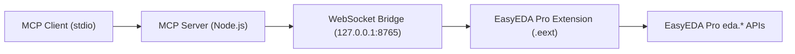

# Architecture

EasyEDA Pro MCP bridges any `stdio` MCP client to the live `eda.*` runtime inside EasyEDA Pro over a localhost WebSocket link.

## Design Principles

1. **Live editor source of truth**: queries run against the active schematic or PCB open in EasyEDA Pro rather than fragile offline file exports.
2. **Read-first by default**: 22 of 24 tools are strictly non-destructive (`readOnlyHint: true`) and never alter editor or project state.
3. **Two-phase confirmed mutations**: high-impact edits (such as PCB DRC rules) require an immutable preview (`easyeda_prepare_drc_edit`), human approval of an exact confirmation token, target-identity checks, and native readback verification.
4. **Actionable diagnostics**: every error returns a deterministic `errorCode` (`wrong_document`, `stale_edit`, `api_unavailable`, etc.) and remediation steps.

## Core Modules

| Module | Source Path | Responsibility |
| --- | --- | --- |
| **CLI Entrypoint** | `src/index.ts` | Starts the WebSocket server, attaches `StdioServerTransport`, and manages process shutdown. |
| **WebSocket Bridge** | `src/bridge/EasyEdaBridge.ts` | Listens on `ws://127.0.0.1:8765`, tracks extension handshake and version compatibility, and dispatches timed RPC requests. |
| **MCP Tool Registry** | `src/mcp/registerTools.ts` | Registers all 24 MCP tools, Zod input schemas, MCP tool annotations, and server-side confirmation guards. |
| **Schematic Engine** | `src/schematic/analysis.ts` | Normalizes schematic primitives, traces nets and components, and evaluates graph-based circuit assertions. |
| **DRC Contracts** | `src/drc/contracts.ts` | Shared browser-safe Zod schemas and canonical JSON validation for PCB design rule operations. |
| **Extension Host** | `extension/src/index.ts` | Connects via `eda.sys_WebSocket`, reports active document metadata, and routes bridge RPC methods to `eda.*` APIs. |
| **DRC Handler** | `extension/src/drcRules.ts` | Reads `eda.pcb_Drc` surfaces, stages immutable previews with 15-minute TTL, verifies PCB identity, and performs readback checks. |
| **Release Identity** | `src/version.ts` | Single source of truth for server (`1.1.0`), extension (`0.2.0`), and bridge protocol (`0.1.0`) versions, verified in `src/version.test.ts`. |

## Request Lifecycle

1. **Tool invocation**: The AI client calls an MCP tool over `stdio` JSON-RPC.
2. **Schema & guard validation**: The MCP server validates parameters with Zod and rejects unconfirmed mutations before touching the WebSocket bridge.
3. **Bridge RPC dispatch**: The server sends `{ kind: "call", requestId, method, params }` over `ws://127.0.0.1:8765`.
4. **Native `eda.*` execution**: The extension executes the requested `eda.*` API calls on the open project and responds with `{ kind: "result", result }` or `{ kind: "error", error }`.
5. **Structured response**: The server returns both formatted text and `structuredContent` to the AI client.

::: warning Stdio Transport Integrity
The MCP server communicates over `stdout` using JSON-RPC. Any diagnostic or debug logging inside `src/` **must** write to `stderr` (`console.error`), never `console.log`.
:::
