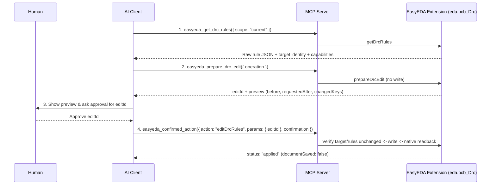

# PCB Design Rule Editing (DRC)

Inspect native PCB design rules, create named rule profiles, and update active board rules through a two-phase **Prepare → Approve → Confirm → Readback** workflow.

::: info Version Requirement
Requires MCP server **`>= 1.1.0`**, extension **`>= 0.2.0`**, and an active **PCB** tab (`documentType: 3`) in EasyEDA Pro. See [Upgrading & Compatibility](./upgrading.md).
:::

## Two-Phase Edit Workflow



## Supported Operations

Pass one operation to `easyeda_prepare_drc_edit`:

| `operation.type` | Payload Fields | Scope & Effect |
| --- | --- | --- |
| `createConfiguration` | `configurationName: string`, `config: object` | `saved_rule_configuration` — Creates a new named rule profile with `allowOverwrite: false` (never overwrites existing/system profiles). |
| `updateCurrentConfiguration` | `config: object` | `active_pcb` — Replaces the active PCB's rule configuration (`{ name, config }.config`). |
| `replaceNetRules` | `rules: object[]` | `active_pcb` — Replaces the entire per-net rule table (`[]` clears the table). |
| `replaceNetByNetRules` | `rules: object` | `active_pcb` — Replaces the net-by-net rule object keyed by category (`{}` clears categories). |
| `replaceRegionRules` | `rules: object[]` | `active_pcb` — Replaces the entire region rule table (`[]` clears the table). |

::: tip Preserving Editor Units & Structure
`easyeda_get_drc_rules` with `scope: "current"` returns `{ name, config }` using the editor's native structure and units (`mm` or `mil`). When calling `createConfiguration` or `updateCurrentConfiguration`, copy the inner `config` object, modify the desired fields, and pass `config` (not the `{ name, config }` wrapper).
:::

### Example Payloads

::: code-group

```json [1. Prepare Profile Creation]
{
  "operation": {
    "type": "createConfiguration",
    "configurationName": "JLCPCB-2Layer-0.15mm",
    "config": {
      "Safe Spacing": {},
      "Track": {},
      "Via Size": {}
    }
  }
}
```

```json [2. Confirm Prepared Edit]
{
  "action": "editDrcRules",
  "params": {
    "editId": "bd549553-e96d-4c9b-bb1f-f8e8ac28cf89"
  },
  "confirmation": "CONFIRM editDrcRules bd549553-e96d-4c9b-bb1f-f8e8ac28cf89"
}
```

:::

## Safety Guarantees & Error Recovery

- **Dual confirmation gate**: Both the MCP server and the browser extension verify `CONFIRM editDrcRules <editId>` before touching `eda.pcb_Drc`.
- **Stale-state protection**: Before writing, the extension re-verifies the PCB `documentId`, `projectId`, `tabId`, WebSocket session generation, and current rule state. Any change returns `stale_edit` without writing.
- **Expiration & single execution**: Previews expire after **15 minutes** (`edit_expired`) and can only be executed **once** (`edit_already_started`).
- **Full readback verification**: An edit is marked `applied` only if `eda.pcb_Drc` returns `true` **and** a subsequent native readback matches the requested JSON.
- **Explicit PCB save**: Applying DRC rules sets `documentSaved: false`. Saving the PCB requires a separate `easyeda_confirmed_action` (`action: "save"`).

::: warning Handling Timeouts (`drc_edit_outcome_unknown`)
If the WebSocket times out or disconnects after a DRC write was dispatched, the server returns `error: "drc_edit_outcome_unknown"` with `retryable: false`. **Never automatically replay the mutation.** Call `easyeda_get_drc_edit_result` with the same `editId` to check whether the write completed.
:::

## Official EasyEDA Pro API References

- [`PCB_Drc`](https://prodocs.easyeda.com/en/api/reference/pro-api.pcb_drc.html) · [`saveRuleConfiguration`](https://prodocs.easyeda.com/en/api/reference/pro-api.pcb_drc.saveruleconfiguration.html) · [`overwriteCurrentRuleConfiguration`](https://prodocs.easyeda.com/en/api/reference/pro-api.pcb_drc.overwritecurrentruleconfiguration.html)
- [`overwriteNetRules`](https://prodocs.easyeda.com/en/api/reference/pro-api.pcb_drc.overwritenetrules.html) · [`overwriteNetByNetRules`](https://prodocs.easyeda.com/en/api/reference/pro-api.pcb_drc.overwritenetbynetrules.html) · [`overwriteRegionRules`](https://prodocs.easyeda.com/en/api/reference/pro-api.pcb_drc.overwriteregionrules.html)
- [`EDMT_EditorDocumentType`](https://prodocs.easyeda.com/en/api/reference/pro-api.edmt_editordocumenttype.html) (`PCB = 3`, `SCHEMATIC_PAGE = 1`, `SYMBOL = 2`, `FOOTPRINT = 4`)
