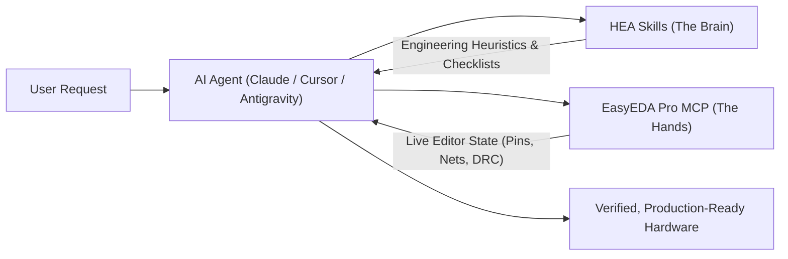

# Hardware Engineering Assistant (HEA)

Supercharge your AI agent with real-world electronics engineering knowledge, DFM checklists, and schematic audit heuristics.

::: tip Official Companion Project
**[HEA (Hardware Engineering Assistant)](https://github.com/VLab-Software/HEA)** is an open-source suite of **Agent Skills** maintained by VLab Software, designed to be used alongside **EasyEDA Pro MCP**.
:::

---

## Why Pair EasyEDA Pro MCP with HEA?

When you connect an LLM to EasyEDA Pro using an MCP server, the model gets access to raw project data (nets, component pins, DRC rules, footprints). However, LLMs by themselves lack deep domain context on manufacturing constraints, PCB physics, and silicon quirks.

| Layer | Role | Example |
| --- | --- | --- |
| **EasyEDA Pro MCP** *(The Hands)* | Reads and writes live project state inside EasyEDA Pro | Calls `easyeda_trace_net`, `easyeda_get_drc_rules`, `easyeda_verify_connections` |
| **HEA Skills** *(The Brain)* | Provides domain methodology, checklists, and heuristics | Verifies decoupling rules, checks MCU boot strapping pins, validates JLCPCB SMT constraints |

Without HEA, an agent might see `GPIO0` connected to ground and consider it a valid connection. **With HEA**, the agent knows that on an ESP32, pulling `GPIO0` low enters bootloader download mode and will warn you before you manufacture the board!



---

## Core Skills Included in HEA

HEA provides modular Agent Skills compatible with **Antigravity**, **Claude Code**, **Cursor**, **Codex**, and other modern agent runtimes:

### 1. `pcb-dfm-jlcpcb`
* **Focus:** Design for Manufacturing (DFM) tailored to the JLCPCB fabrication and SMT assembly process.
* **Checks:**
  * Minimum trace width, clearance, and annular rings.
  * SMT component selection: prioritizing JLCPCB **Basic Library** components over **Extended Library** to minimize setup and reel-change fees.
  * Component rotation, orientation markings, and fiducial placements.

### 2. `mcu-strapping-and-pinout`
* **Focus:** Microcontroller boot pins, power sequencing, and logic level integrity.
* **Checks:**
  * Strapping pin safety checks (ESP32 GPIO0/2/12/15, STM32 BOOT0, etc.).
  * 3.3V vs 5.0V voltage domain isolation and bidirectional level shifter requirements.
  * Crystal and oscillator layout guidelines and load capacitor calculations.

### 3. `power-tree-and-thermal`
* **Focus:** Power rail topology, thermal dissipation, and decoupling capacitors.
* **Checks:**
  * Calculation of power dissipation for linear regulators ($P = (V_{in} - V_{out}) \times I_{load}$) and warnings when a switching regulator (Buck) is required.
  * Decoupling capacitor placement heuristics (100 nF per VDD pin + bulk capacitance).
  * Inrush current protection and reverse-polarity protection.

### 4. `schematic-review-audit`
* **Focus:** Pre-layout electrical and semantic review of schematics.
* **Checks:**
  * Single-node nets and accidental net naming typos (e.g., `VCC_3V3` vs `VCC3V3`).
  * Pull-up resistor presence on open-drain buses ($I^2C$, Reset lines, Interrupts).
  * USB-C CC1/CC2 $5.1\text{ k}\Omega$ pull-down resistor verification for standard 5V sink operation.

---

## How to Install and Use HEA

### Step 1: Clone or Download HEA

Clone the HEA repository into your workspace or skills directory:

```bash
git clone https://github.com/VLab-Software/HEA.git
```

### Step 2: Configure in Your AI Client

::: code-group

```bash [Claude Code CLI]
# Place HEA skills in your project or global Claude skills folder
cp -r HEA/skills/* ~/.claude/skills/
```

```bash [Antigravity]
# Copy HEA skills to your Antigravity skills directory
cp -r HEA/skills/* ~/.gemini/antigravity/skills/
```

```bash [Cursor & VS Code]
# Copy the rules or skills into your project workspace
cp -r HEA/skills .cursor/skills/
```

:::

---

## Example Workflow: HEA + EasyEDA Pro MCP

When both **EasyEDA Pro MCP** and **HEA** are enabled, you can run prompts that combine real-time inspection with rigorous engineering:

```text
Run a full pre-fabrication DFM audit on the active PCB using easyeda_get_drc_rules and the HEA pcb-dfm-jlcpcb skill.
Flag any traces thinner than 0.127 mm, verify annular rings, and check if our BOM components match the JLCPCB SMT capabilities.
```

Or for microcontroller schematics:

```text
Inspect the ESP32 microcontroller in the current schematic using easyeda_get_component_pins and the HEA mcu-strapping-and-pinout skill.
Verify that strapping pins (GPIO0, GPIO2, GPIO12, GPIO15) are configured properly and will not prevent normal booting.
```

---

## Next Steps

* ⭐ Star and contribute to **[VLab-Software/HEA on GitHub](https://github.com/VLab-Software/HEA)**.
* Check out [Practical Workflows](./workflows.md) for more prompts.
* Explore all available bridge operations in the [Tools Reference](./tools.md).
